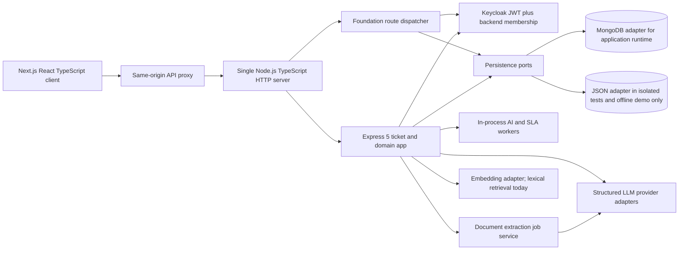

# Current and Target Architecture

**Status:** Phase 2 architecture alignment, 23 November 2026. This document describes verified repository structure and distinguishes it from production targets that remain unimplemented or unapproved.

## Purpose and constraints

The system is a multi-tenant support application with role-scoped ticket workflows, AI-assisted triage, document and policy processing, SLA evaluation, reporting, and organisation administration. It is implemented as a modular monolith. Tenant isolation and human review are application requirements: authenticated identity is matched to an active backend user and organisation membership, and the API derives permissions from that membership.

The project owner selected managed MongoDB Atlas. The application now defaults to MongoDB for development and production and does not permit JSON persistence outside `NODE_ENV=test`. The configured Atlas URI passed a read-only ping and application index initialization; the approved record import is complete, while production traffic cutover, backup and restore remain unverified. JSON adapters are retained for isolated tests and the synthetic offline demo only.

## Current system context

The browser client is shown for system context only; this Phase 2 backend/architecture pass does not change frontend code. The HTTP server composes a foundation dispatcher and an Express application within one process. `backend/src/integrated-app.ts`, `backend/src/app.ts`, and `backend/src/modules/tickets/api.ts` are the current composition points. The domain modules cover identity, organisations, teams, tickets, documents, policies, SLA, AI, knowledge, and reporting. There is no implemented performance-measurement domain module; reference KPA/KPI documents are not executable scoring rules.

## Architecture alignment

| Requirement or proposal | Current implementation | Alignment and implication |
|---|---|---|
| React and TypeScript client | Next.js App Router using React and TypeScript | Compatible framework choice; browser workflows and API authorization remain separate concerns. |
| Node.js, TypeScript, REST `/api/v1` | Node/TypeScript server with foundation routing plus Express 5 domain routes | REST and language align. The hybrid dispatcher is a current implementation detail that should be preserved unless a later change justifies consolidation. |
| Modular monolith | Domain modules in one backend process | Aligned. Do not infer independently deployable services from module boundaries. |
| MongoDB | Atlas selected as production target; Mongo and JSON adapters implemented | Direction selected. Atlas operation, migration, backup/restore, and production-sized query behavior are unverified. |
| Zod or equivalent boundary schemas | Shared validation and domain-specific parsers/schemas | Typed validation is present. Exact schema coverage is tracked in API/OpenAPI verification. |
| AI provider and orchestration | Structured provider adapters and typed AI workflows; Inception/Groq live adapters and Mistral embedding adapter are present | Adapter boundary exists. Provider selection, data-processing approval, and target-provider requirements remain owner decisions. No provider switch is implied. |
| Vector retrieval | Embedding adapter exists; knowledge retrieval currently uses lexical matching | Atlas Vector Search is not implemented or required by current behavior. Search technology and semantic-search acceptance remain open. |
| Background processing | AI/SLA workers run in the API process; document jobs use the current extraction queue composition | Not independently deployable. Queue, durability, retry ownership, and worker topology require a deployment decision. |
| Private document storage and malware scanning | Local private-file storage with API authorization and file validation | Not production object storage; malware scanning, retention, deletion, and recovery are unverified. |
| Automated verification | Node built-in test runner with HTTP/API tests | The supplied prompt's Jest/Supertest/Playwright choices are recommendations, not existing implementation. Browser E2E is not established. |

## Trust boundaries and invariants

- Keycloak authenticates the principal. Backend user status, active organisation membership, role, and permissions determine authorization; client-side role presentation is not an authorization boundary.
- Tenant-owned reads and writes must retain organisation scope. Request-supplied organisation IDs do not establish access.
- AI output is schema-validated and treated as a recommendation. Preserve source provenance and evidence, and keep human review for governed changes. Provider or validation failures must not mutate the source ticket or policy.
- Uploaded documents and retrieved text are untrusted input. Do not expose credentials, raw provider output, or sensitive content in logs.
- Audit visibility and event production are separate capabilities: the current admin feed aggregates existing records and does not prove that all mutations emit a common audit event.

## Target deployment boundary and open decisions

The production target is a backend application connected to managed MongoDB Atlas and Keycloak, with credentials supplied through deployment secret configuration. Before production use, the owner still needs to select/approve hosting and network controls, private file storage and malware scanning, worker/queue deployment, data retention and deletion behavior, monitoring and recovery objectives, and any provider/data-processing requirements. No infrastructure product, rate limit, SLA target/calendar, or retention period is selected by this document.

See [production readiness](../deployment/production-readiness.md), [database design](Database-Design.md), and [integration verification](../api/Integration-Verification.md) for evidence and blockers.
