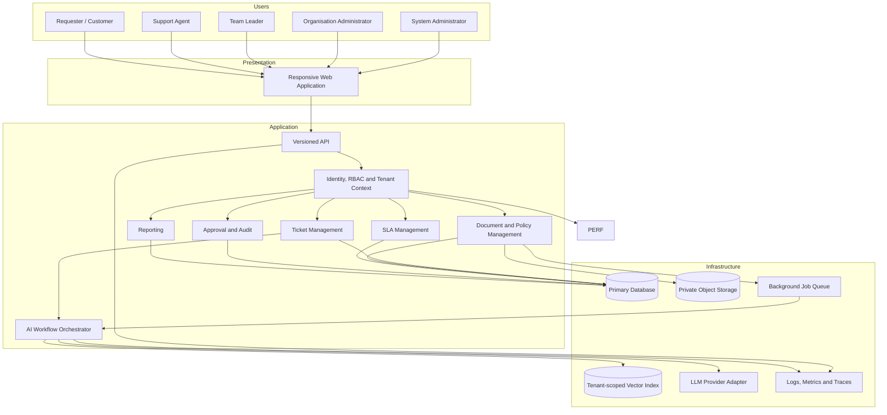

# Architecture — Universal AI-Powered Support Management & Performance Platform

**Status:** Proposed logical architecture for review; validate against the existing repository before implementation.

## 1. Purpose

Define a universal, configurable, multi-tenant platform for support operations, policy and SLA governance, AI-assisted ticket triage, and agent/leader performance management.

## 2. Architectural principles

- Multi-tenant isolation is enforced across every data and processing path.
- Organisation-specific policies, SLAs and workflows are configuration, not hardcoded application logic.
- AI proposes and explains; authorised humans approve governed changes and consequential actions.
- Performance scores are calculated by deterministic, versioned business rules using verified data.
- Existing repository functionality is preserved unless an approved, evidence-based change is justified.
- Start with a modular monolith and extract services only when scale or operational constraints justify it.
- All material decisions and AI executions are traceable.

## 3. Logical architecture

## 4. Major layers

| Layer | Responsibility |
|---|---|
| Presentation | Role-aware screens, forms, dashboards and accessibility |
| API | Authentication, validation, authorisation, versioned endpoints and error mapping |
| Application | Use-case orchestration, transactions and workflow coordination |
| Domain | Tenant, ticket, policy, SLA, performance, approval and reporting rules |
| Infrastructure | Database, object storage, queues, LLM providers, embeddings and notifications |
| Observability | Correlation IDs, structured logs, metrics, traces and health checks |

## 5. Domain modules

1. Tenant and organisation administration.
2. Identity, users, roles and permissions.
3. Departments and teams.
4. Document repository and ingestion.
5. Policy lifecycle and approval.
6. SLA configuration and evaluation.
7. Ticket intake and workflow.
8. AI triage and knowledge retrieval.
11. Coaching and feedback.
12. Dashboards and reporting.
13. Audit and observability.

## 6. Data ownership and tenant isolation

Every tenant-owned entity is scoped to an organisation. Tenant context must be derived from the authenticated principal and verified membership. Repositories must require tenant scope for tenant-owned reads and writes. Apply the same rule to object storage paths, vector retrieval, jobs, exports, caches and analytics.

## 7. AI governance

Uploaded files, ticket descriptions, retrieved passages and external content are untrusted. The AI workflow must:
- Use explicit task-specific components and validated schemas.
- Keep retrieved evidence tenant-scoped and permission-filtered.
- Reference approved policies and knowledge sources where applicable.
- Expose uncertainty and low confidence.
- Never activate extracted policies without approval.
- Never execute governed actions without the required approval.
- Record model/provider, prompt/config version, execution ID, evidence references and reviewer outcome where available.

## 8. Database decision

The capstone specification recommends MongoDB. The accompanying project brief asks for a relational database design. This is an unresolved architecture decision. Assess the current repository, relationship complexity, transaction requirements, reporting needs, operational skills and migration cost before choosing. Do not silently introduce a second primary database.

## 9. Deployment view

Deploy the web frontend, API and background worker as independently scalable processes where useful, while retaining a modular-monolith codebase initially. Use managed database and private object storage where appropriate. Keep provider credentials in a secret manager or secure environment configuration. Exact cloud provider and topology are pending approval.

## 10. Decisions requiring coach approval

- Primary database and migration strategy.
- Tenant isolation model.
- Identity provider and authentication/session model.
- Document storage, retention and malware scanning.
- Queue/background worker technology.
- LLM providers, model selection and data processing constraints.
- Embedding model and vector search technology.
- Notification integrations.
