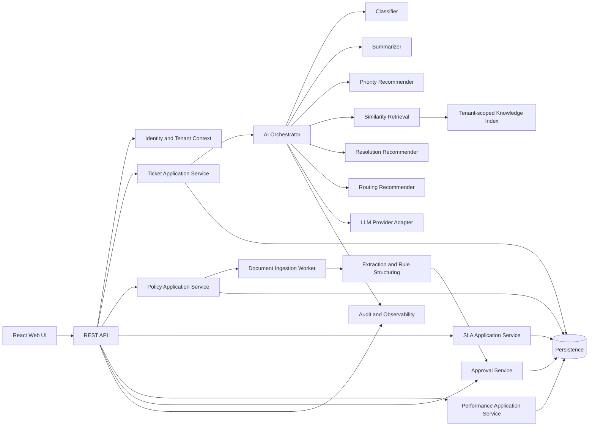

# Component Design

## 1. Component diagram

## 2. Component contracts

| Component | Input | Output |
|---|---|---|
| Ticket intake | Authenticated tenant context and validated ticket payload | Persisted ticket and identifier |
| Document ingestion | Private file reference and tenant context | Extracted text and processing status |
| Rule extraction | Extracted text and document/version metadata | Candidate structured rules with evidence and uncertainty |
| Policy approval | Candidate rule, reviewer decision and reason | Approved/rejected version and audit event |
| Ticket classifier | Ticket content and configured taxonomy | Category labels, evidence and uncertainty |
| Summarizer | Original ticket | Structured issue/customer-impact summary |
| Priority recommender | Ticket evidence and active priority rules | Priority recommendation and factors |
| Similarity retrieval | Tenant context, query and filters | Permission-filtered evidence references |
| Resolution recommender | Ticket and retrieved approved evidence | Ordered suggested steps with citations |
| Routing recommender | Ticket, routing rules and permitted workload data | Suggested team and rationale |
| SLA evaluator | Ticket timestamps, calendar and active SLA version | Due times, risk and evaluation explanation |
| Approval manager | Proposed action and approval policy | Decision, actor, reason and audit record |

## 3. Design constraints

- No component may bypass tenant/permission checks.
- AI components do not directly mutate policy configuration or execute consequential ticket actions.
- All downstream consumers validate AI outputs.
- Evidence must retain source identifiers and version information.
- Provider-specific code remains behind adapters.
