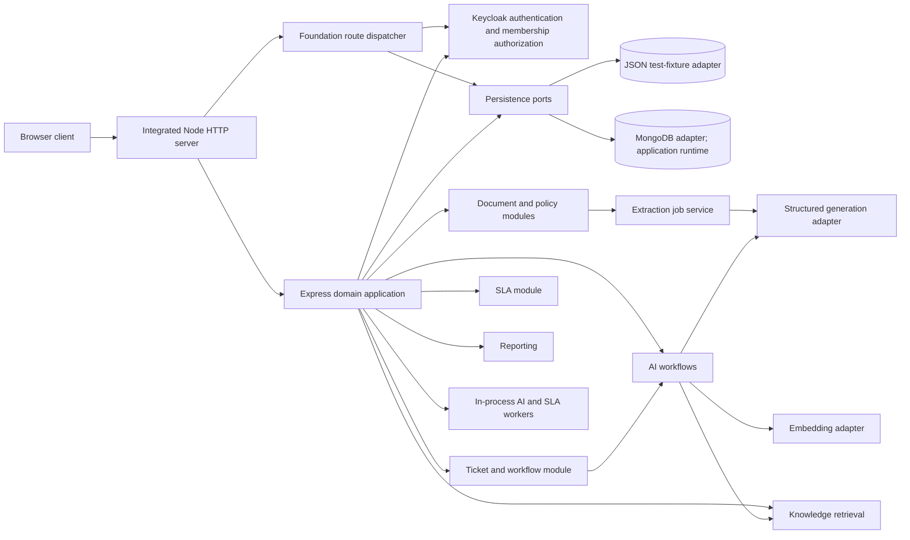

# Component Design

**Status:** Current implemented components, reviewed 23 November 2026.

## Component view

The `Browser client` node is context only; frontend implementation is outside this backend architecture pass. There is no standalone performance service, approval service, durable external queue, or vector index in this component view. Approval and audit behavior is implemented within domain workflows and existing audit records.

## Component responsibilities and constraints

| Component | Responsibility | Contract / constraint |
|---|---|---|
| Foundation dispatcher | Identity, organisation, department, team, and health endpoints | Uses shared authentication and persistence dependencies. |
| Express domain application | Ticket, workflow, document, policy, SLA, AI, knowledge, reporting, audit and OpenAPI routes | API authorization and tenant scope are enforced server-side. |
| Persistence adapters | MongoDB for application runtime; JSON only for isolated tests and offline demo | Preserve IDs, tenant boundaries, schema validation, and transaction scope. Atlas connectivity still depends on environment configuration. |
| Ticket/workflow module | Ticket lifecycle, access scopes, comments, assignment, escalation and workflow state | Existing product semantics and API tests define supported operations. |
| Document/policy modules | Upload metadata, versions, text conversion, extraction candidates, review and activation | Candidate extraction cannot silently activate policy. File bytes remain in local storage today. |
| SLA module | Resolve configured rules and evaluate deadlines/risk | Do not activate unapproved target values or escalation thresholds. |
| AI workflows | Classification, summary, recommendations, retrieval and operation metadata | Structured output validation, provenance, safe failure, and human review remain required. |
| Retrieval | Provides permitted evidence references for recommendations | Current retrieval is lexical; embedding provider does not mean vector search is active. |
| In-process workers | Poll AI and SLA work in backend runtime; coordinate extraction jobs | Not independently deployable; extraction queue is not an external durable broker. |
| Audit feed | Admin-scoped aggregation of existing audit records | Not a guarantee of complete audit-event coverage across all mutations. |

## Cross-component invariants

- Authenticate and derive active tenant membership before tenant data access.
- Keep authorization at the backend boundary even when a client hides a control.
- Validate external and provider data at boundaries; preserve safe error behavior.
- Keep provider adapters replaceable without assuming a provider change.
- Preserve human review and evidence/provenance for AI recommendations and policy candidates.
- Never infer missing business rules, retention periods, limits, or deployment products from component diagrams.
