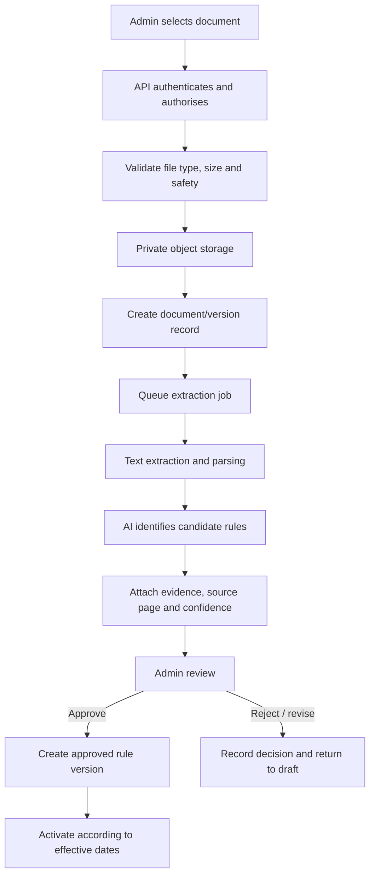
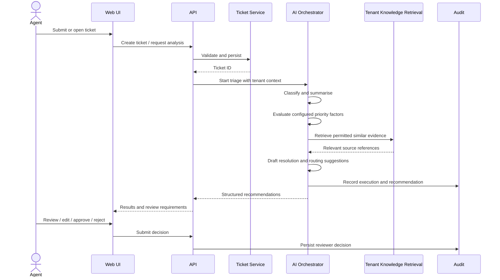
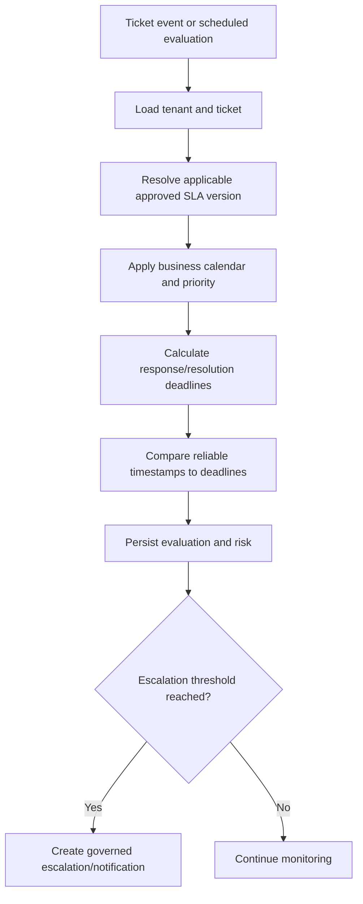
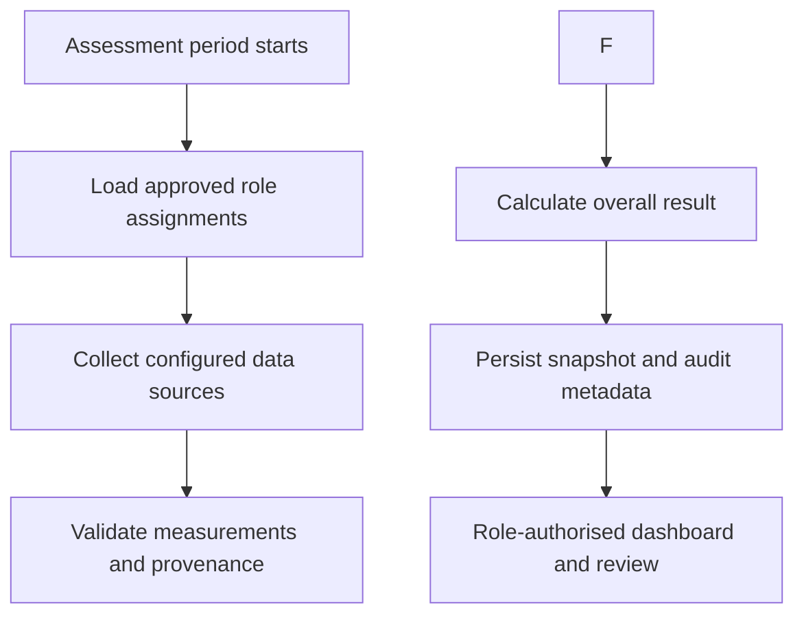

# Data Flow Design

## 1. Document and policy ingestion

## 2. Ticket triage

## 3. SLA monitoring

## 5. Data classification and protection

| Data | Handling |
|---|---|
| Tenant policies and uploaded documents | Private storage, tenant scope, document-level permissions |
| Tickets and attachments | Tenant/ownership scope, least-privilege access, retention controls |
| AI prompts and retrieved evidence | Minimise/redact sensitive content; permission-filter before retrieval |
| Employee performance records | Restricted role access, auditable changes and retention policy |
| Audit records | Append-oriented access, restricted visibility and tamper-resistance appropriate to deployment |
| Secrets | Secret manager/environment; never source control or client bundle |
