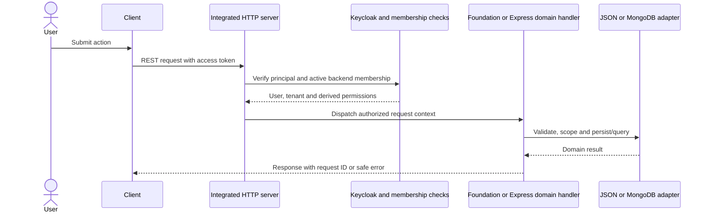
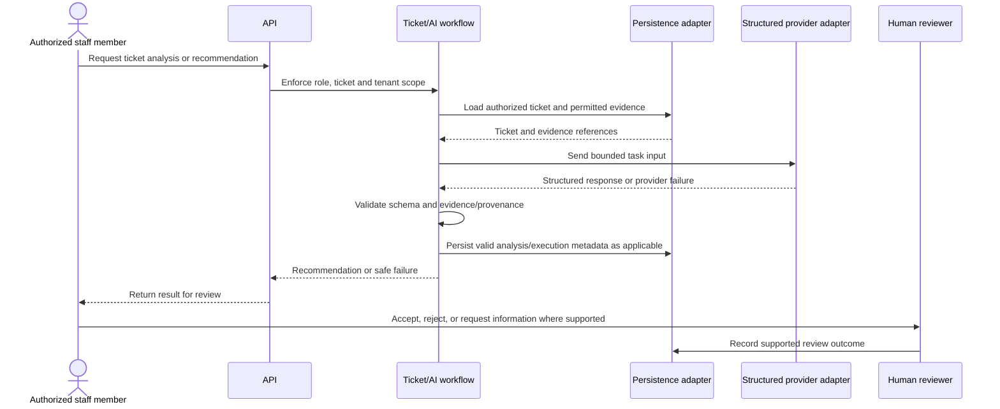

# Data Flow Design

**Status:** Current behavior with production gaps, reviewed 23 November 2026.

## Authenticated API request

## Ticket AI workflow

AI does not directly change source ticket priority/status/assignment or activate policy merely by returning a recommendation. Provider output that fails schema or evidence checks is rejected safely. The original ticket remains the source of truth. The exact workflow and available human review actions depend on the API operation; there is no universal approve/reject action.

## Document and policy extraction

1. An authorized user uploads a document through a tenant-scoped API.
2. The application validates supported type/size and stores metadata plus a private local file reference.
3. A document version and extraction job/history are recorded.
4. The configured converter extracts text; the extraction adapter receives bounded text and document context.
5. Provider output is parsed and strictly schema-validated. Invalid output fails the job/response without creating approved policy rules.
6. Valid extracted rules remain candidates with source evidence/provenance for a human review and supported policy lifecycle.

The current extraction queue composition is not an independently deployable durable broker. Document bytes are local, and malware scanning, external private storage, retention, and restore behavior have not been verified for production.

## SLA evaluation

The backend resolves applicable configured policy/calendar inputs, evaluates ticket timestamps, and persists evaluation history. A worker polls from the application runtime. SLA targets and escalation triggers remain governed by approved tenant configuration; no illustrative reference value is activated by this flow. Worker deployment, external notification, and recovery behavior remain open.

## Audit and observability data

Requests carry request IDs and structured logs record safe request metadata. AI operations and selected policy/knowledge/ticket history are persisted. `/api/v1/audit-logs` aggregates existing records under its current admin authorization. It does not yet establish a common append-only ledger for every identity/team/configuration mutation. Do not interpret the feed as complete audit coverage.

## Data protection

| Data | Current handling | Production gap |
|---|---|---|
| Tenant application records | Tenant-scoped API and repository filters; MongoDB at runtime and JSON test fixtures | Configured Atlas connectivity, indexes and import passed; authenticated acceptance, backup/restore, traffic cutover and scale still require verification. |
| Uploaded files and attachments | Local private storage behind scoped API routes | Production object storage, scanning, retention/deletion, and recovery are not selected/verified. |
| Prompts and retrieved evidence | Bounded provider calls and permission-scoped retrieval paths | Provider/data-processing approval and deployment redaction controls require verification. |
| Audit/history | Existing domain history and audit records | Complete event coverage and tamper/recovery controls are not established. |
| Credentials | Environment-based backend configuration; excluded from client bundle/source examples | Production secret-management integration is not selected or verified. |
