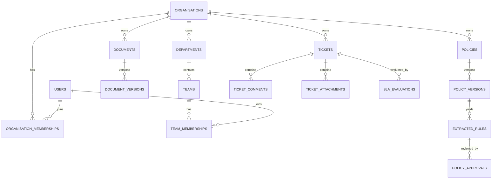

# Database Design

## 1. Database decision and status

The source materials contain two directions: the capstone specification proposes MongoDB collections, while the universal-platform brief explicitly asks for a scalable relational data model and ERD. The final primary database is therefore **an approval decision**, not assumed here. This design presents a relational logical model because that is explicitly requested for Phase 2. Validate it against the existing repository and coach decision before implementation.

## 2. Design principles

- Every tenant-owned table includes `organisation_id`.
- Use primary keys, foreign keys, unique constraints and indexes.
- Store source provenance for measurements and AI recommendations.
- Keep uploaded file bytes in private object storage; persist metadata and object keys in the database.
- Store timestamps in UTC and retain relevant business timezone/calendar configuration.

## 3. Proposed logical entities

| Entity | Key fields (illustrative) | Relationships |
|---|---|---|
| organisations | id, name, status, settings | Parent of tenant-owned records |
| users | id, email, display_name, status | User memberships and actions |
| organisation_memberships | id, organisation_id, user_id, status | Links users to organisations |
| roles | id, organisation_id, name | Organisation role definitions |
| permissions | id, code, description | Permission catalogue |
| role_permissions | role_id, permission_id | Role permission mapping |
| departments | id, organisation_id, name | Organisation departments |
| teams | id, organisation_id, department_id, name | Department teams |
| team_memberships | team_id, user_id, role_in_team | Team membership |
| documents | id, organisation_id, storage_key, type, status | Document versions |
| document_versions | id, document_id, version, checksum, effective dates | Versioned file content |
| policies | id, organisation_id, policy_type, owner_id, status | Policy versions and rules |
| policy_versions | id, policy_id, version, status, effective_from, effective_to | Immutable policy version |
| extracted_rules | id, policy_version_id, rule_type, payload, evidence | Candidate/approved structured rules |
| policy_approvals | id, extracted_rule_id, reviewer_id, decision, reason | Approval decisions |
| sla_policies | id, organisation_id, name, version, status | SLA targets and conditions |
| sla_calendars | id, organisation_id, timezone, business_hours | Working calendars |
| sla_evaluations | id, ticket_id, policy_version, due_at, risk, evaluated_at | Ticket SLA history |
| tickets | id, organisation_id, requester_id, team_id, status, priority | Ticket workflow |
| ticket_comments | id, ticket_id, author_id, body, visibility | Ticket discussion |
| ticket_attachments | id, ticket_id, storage_key, filename, content_type | Private file references |
| ticket_ai_analyses | id, ticket_id, execution_id, output, model_version | AI analysis history |
| knowledge_articles | id, organisation_id, status, approved_version_id | Approved knowledge |
| knowledge_versions | id, article_id, version, content, status | Knowledge history |
| role_performance_assignments | id, organisation_id, role_id, kpa_id, effective dates | Role-specific performance framework |
| performance_measurements | id, organisation_id, kpi_id, subject_user_id, period, value, provenance | Raw/verified measures |
| performance_assessments | id, organisation_id, subject_user_id, period, config_version, score | Assessment snapshots |
| performance_results | id, assessment_id, kpi_id, measured_value, score, weight | Assessment details |
| coaching_records | id, organisation_id, employee_id, leader_id, action, due_at | Coaching and development |
| approvals | id, organisation_id, target_type, target_id, status | Governed action approvals |
| audit_logs | id, organisation_id, actor_id, action, before, after, created_at | Audit history |
| agent_executions | id, organisation_id, workflow, status, model, duration | AI/job traceability |

## 4. Entity relationship diagram

## 5. Index and constraint recommendations

- Unique organisation membership: `(organisation_id, user_id)`.
- Ticket queue: `(organisation_id, status, priority, created_at)`.
- Ticket requester: `(organisation_id, requester_id, created_at)`.
- Team queue: `(organisation_id, team_id, status, priority)`.
- Policy lookup: `(organisation_id, policy_type, status, effective_from)`.
- Version uniqueness: `(parent_id, version)`.
- Audit lookup: `(organisation_id, target_type, target_id, created_at)`.
- AI execution lookup: `(organisation_id, execution_id)`.

Use foreign keys and tenant-consistency constraints where supported. A child row's organisation must match its parent organisation; enforce this through composite constraints or service-level invariant checks.

## 6. Retention and deletion

Define organisation-configurable retention policies, legal holds and deletion workflows. Consider pseudonymisation where historical aggregate reporting must be retained. The exact retention periods are not specified in the source requirements and require approval.

## 7. Outstanding decisions

Primary database engine, identifier strategy, partitioning strategy, object storage, vector index, encryption/key management, backup/restore and data residency remain to be approved.
