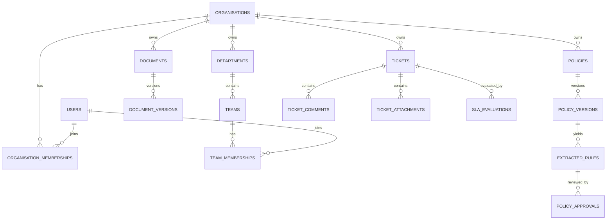

# Database Design

## 1. Database decision and status

**Decision (23 November 2026):** the project owner selected managed MongoDB Atlas as the application database. Normal application startup requires MongoDB in development and production; JSON persistence is restricted to isolated tests and the offline synthetic demo. The configured Atlas URI passed a read-only ping and index initialization. The approved import loaded 80 validated records across 18 collections into the empty target, verified by per-collection counts; source JSON remains unchanged. Backup/restore and production-scale query behavior remain unverified. This document's proposed relational ERD is historical input and must not be treated as the implemented MongoDB schema.

## 2. Design principles

- Every tenant-owned MongoDB document carries `organisationId`; repository methods scope reads and writes to the authenticated tenant where applicable.
- Existing application identifiers are stored as string MongoDB `_id` values. Unique and compound indexes enforce only invariants already represented by the application.
- Preserve source provenance and evidence for policy extraction, AI recommendations, SLA evaluation, and human review.
- MongoDB stores application records and file metadata. Document and ticket-attachment bytes currently remain in local private storage, not Atlas or production object storage.
- Store timestamps in UTC and use configured business calendars/time zones for calculations; tenant-approved values are required before SLA activation.

## 3. Historical conceptual entity list (not the physical schema)

The following illustrative relational-style list came from the earlier design proposal. It is not a set of deployed SQL tables, and several concepts (notably performance/coaching entities) do not have implemented backend modules. Do not use it to infer that performance metrics or coaching records are collected or calculated.

| Entity | Key fields (illustrative) | Relationships |
|---|---|---|
| organisations | id, name, status, settings | Parent of tenant-owned records |
| users | id, email, display_name, status | User memberships and actions |
| organisation_memberships | id, organisation_id, user_id, status | Links users to organisations |
| roles | id, organisation_id, name | Organisation role definitions |
| permissions | id, code, description | Permission catalogue |
| role_permissions | role_id, permission_id | Role permission mapping |
| departments | id, organisation_id, name | Organisation departments |
| teams | id, organisation_id, department_id, name | Department teams |
| team_memberships | team_id, user_id, role_in_team | Team membership |
| documents | id, organisation_id, storage_key, type, status | Document versions |
| document_versions | id, document_id, version, checksum, effective dates | Versioned file content |
| policies | id, organisation_id, policy_type, owner_id, status | Policy versions and rules |
| policy_versions | id, policy_id, version, status, effective_from, effective_to | Immutable policy version |
| extracted_rules | id, policy_version_id, rule_type, payload, evidence | Candidate/approved structured rules |
| policy_approvals | id, extracted_rule_id, reviewer_id, decision, reason | Approval decisions |
| sla_policies | id, organisation_id, name, version, status | SLA targets and conditions |
| sla_calendars | id, organisation_id, timezone, business_hours | Working calendars |
| sla_evaluations | id, ticket_id, policy_version, due_at, risk, evaluated_at | Ticket SLA history |
| tickets | id, organisation_id, requester_id, team_id, status, priority | Ticket workflow |
| ticket_comments | id, ticket_id, author_id, body, visibility | Ticket discussion |
| ticket_attachments | id, ticket_id, storage_key, filename, content_type | Private file references |
| ticket_ai_analyses | id, ticket_id, execution_id, output, model_version | AI analysis history |
| knowledge_articles | id, organisation_id, status, approved_version_id | Approved knowledge |
| knowledge_versions | id, article_id, version, content, status | Knowledge history |
| role_performance_assignments | id, organisation_id, role_id, kpa_id, effective dates | Role-specific performance framework |
| performance_measurements | id, organisation_id, kpi_id, subject_user_id, period, value, provenance | Raw/verified measures |
| performance_assessments | id, organisation_id, subject_user_id, period, config_version, score | Assessment snapshots |
| performance_results | id, assessment_id, kpi_id, measured_value, score, weight | Assessment details |
| coaching_records | id, organisation_id, employee_id, leader_id, action, due_at | Coaching and development |
| approvals | id, organisation_id, target_type, target_id, status | Governed action approvals |
| audit_logs | id, organisation_id, actor_id, action, before, after, created_at | Audit history |
| agent_executions | id, organisation_id, workflow, status, model, duration | AI/job traceability |

## 4. Historical conceptual relationship diagram

## 5. Current MongoDB indexes and persistence behavior

MongoDB uses string `_id` values aligned with the existing application IDs during the first migration. Every tenant-owned document includes `organisationId`; repositories must scope reads and writes by that value. Add unique compound indexes for membership, version and external-source identities where the service already enforces those invariants. Multi-record work uses the Node driver's `withTransaction` helper so the driver can retry labeled transient transaction failures; nested repository calls reuse the active session. Production and integration transaction testing therefore require a replica set. Atlas is the selected production target.

The implemented collection namespace is `app_` plus the logical collection name. It includes `app_organisations`, `app_users`, `app_memberships`, `app_departments`, `app_teams`, `app_team-memberships`, `app_documents`, `app_documentVersions`, `app_policies`, `app_policyVersions`, `app_extractedRules`, `app_policyApprovals`, `app_auditLogs`, `app_extractionJobs`, `app_documentExtractions`, `app_slaEvaluations`, `app_ai-analyses`, `app_ai-workflow-runs`, `app_ai-operations`, `app_ticket-workflows`, and `app_tickets`. The configured database has 21 application collections after index initialization; 18 of them received migrated records. The master prompt's 18 names are conceptual entities, not a requirement for 18 separate physical collections. The detailed entity-to-collection/embedded-record mapping is in the [Phase 7 persistence audit](../assessment/phase-7-database-persistence-audit.md). In particular, comments and attachment metadata are embedded in tickets; classifications and summaries share analysis records; historical tickets remain in the ticket collection; and approvals/audit events are distributed among domain records. Published knowledge uses approved policy/version records rather than a separate knowledge-base collection.

Indexes currently cover tenant lookup; case-insensitive unique user email and organisation name; organisation/user and team/user memberships; document/policy versions; document and extraction history; policy approval and extracted-rule lookup; SLA and AI history; AI job polling; audit history; ticket queues, requester/team scope, open escalations; and one active workflow per tenant. `MongoFileStore.initialize()` completed against the configured Atlas database, executing the current index definitions. Legacy external source fields remain readable on old ticket records, but the Jira webhook and its source-identity index creation were removed. Exact compound keys are in `backend/src/infrastructure/persistence/mongodb/mongo-file-store.ts` and `mongo-ticket-stores.ts`.

The current adapter provisions tenant, user-membership, version, extraction job/history, policy approval, extracted-rule, SLA-history, AI-history, AI-job polling, ticket queue, open escalation, active-workflow, case-insensitive unique user-email and unique organisation-name indexes. Identity, organisation, team, document, policy/version-backed approved knowledge, SLA history, AI history, AI job polling, ticket detail, and open escalation reads use structured MongoDB filters with tenant scope where applicable. Team, membership, document, policy, extraction job/history, SLA-history, AI-operation, and AI-history mutations use tenant-scoped MongoDB reads and record-level writes. User and organisation creation use direct inserts; updates/deletes use MongoDB `_id` point operations. Ticket status, priority, team and requester filters plus pagination are executed in MongoDB when free-text search is absent; free-text ticket matching remains application-side. Ticket/workflow mutations pass tenant scope into MongoDB transactions; compatibility whole-collection operations remain for some legacy/global data and some broad list paths need bounded query work before production-sized use. Workflow-run documents map their domain `runId` to MongoDB `_id` while preserving existing JSON/API fields. Atlas connectivity, index initialization, and the approved 80-record import are verified; backup/restore and production query sizing are not.

## 6. Retention and deletion

Define organisation-configurable retention policies, legal holds and deletion workflows. Consider pseudonymisation where historical aggregate reporting must be retained. The exact retention periods are not specified in the source requirements and require approval.

## 7. Outstanding decisions

The configured Atlas project, cluster and database user passed connectivity and index initialization. Production least-privilege/network controls, backup/restore evidence, data residency, object storage, vector index, encryption/key management and application hosting remain to be verified or approved. Retention periods remain unspecified and require approval.
