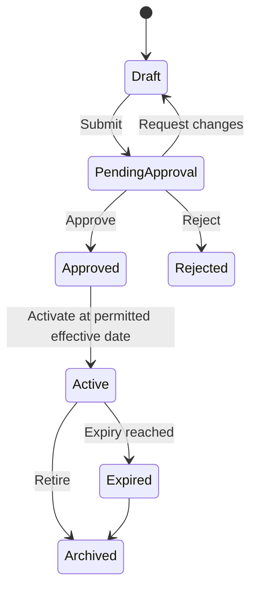

# Low-Level Design (LLD)

## 1. Design conventions

- TypeScript strict mode where TypeScript is used.
- Validate external input at boundaries (Zod is the recommended option in the capstone specification).
- Keep controllers thin; place use-case orchestration in application services.
- Keep domain rules independent of UI and provider SDKs.
- Access persistence through tenant-scoped repositories.
- Use explicit DTOs and versioned contracts.
- Store timestamps in UTC; apply configured organisation/business time zones for calendar calculations.

## 2. Suggested backend module structure

```text
src/
  app.ts
  server.ts
  config/
  shared/
    errors/
    middleware/
    validation/
    logging/
    auth/
    tenancy/
  modules/
    organisations/
    identity/
    teams/
    documents/
    policies/
    sla/
    tickets/
    ai/
    knowledge/
    coaching/
    approvals/
    reporting/
    audit/
  infrastructure/
    database/
    object-storage/
    queue/
    llm/
    embeddings/
  workers/
  tests/
```

Adapt this structure to the repository's existing conventions instead of forcing a rewrite.

## 3. Suggested module internals

Each domain module may contain:
- `routes/` — route registration.
- `controllers/` — HTTP translation only.
- `schemas/` — request/response validation.
- `services/` — application use cases.
- `domain/` — entities, value objects and business rules.
- `repositories/` — persistence interfaces and implementations.
- `mappers/` — persistence/API transformations.
- `tests/` — unit and integration tests.

## 4. Tenant-scoped repository contract

A tenant-owned repository method should require tenant scope explicitly. Conceptual example:

```ts
type TenantContext = {
  organisationId: string;
  userId: string;
  roles: string[];
};

interface TicketRepository {
  findById(
    tenant: TenantContext,
    ticketId: string
  ): Promise<Ticket | null>;

  list(
    tenant: TenantContext,
    filters: TicketFilters
  ): Promise<PaginatedResult<Ticket>>;
}
```

Do not trust an organisation ID supplied in a request body as proof of access. Resolve and validate membership from the authenticated identity.

## 5. Policy lifecycle state machine



Only approved, effective, active versions may be consumed as enforceable rules. Every transition records actor, timestamp, reason and version.

## 6. AI workflow contracts

Each AI component should accept a typed input containing tenant context, execution ID, task-specific content and permitted evidence. Outputs should include structured result, confidence/uncertainty, evidence references, model/config version and warnings. Validate output before persistence or downstream use.

Example conceptual result:

```ts
type EvidenceReference = {
  sourceType: "approved_policy" | "knowledge_article" | "historical_ticket";
  sourceId: string;
  version?: string;
  excerpt?: string;
};

type Recommendation<T> = {
  result: T;
  confidence?: number;
  evidence: EvidenceReference[];
  warnings: string[];
  executionId: string;
  requiresHumanReview: boolean;
};
```

## 8. Error handling and observability

Use a consistent error envelope with stable error code, safe message, request ID and field errors where applicable. Do not expose stack traces or secrets. Record request ID, execution ID, module, status, duration and relevant usage metadata. Avoid unnecessary personal data in logs.

## 9. Concurrency and idempotency

Use idempotency keys for retryable external ingestion and consequential action requests where appropriate. Protect policy activation and approval transitions against concurrent updates using version checks or optimistic concurrency. Make background jobs safe to retry.
